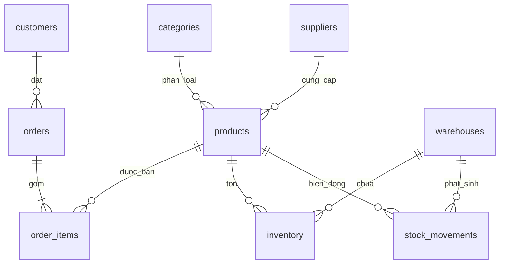

# Từ điển dữ liệu

CSDL PostgreSQL cho doanh nghiệp giả lập Sao Việt. Bộ seed cố định tạo 9 bảng và tối thiểu 2.000 dòng. Tất cả tên/người/email là hư cấu. Đơn đã giao được gán ngày giao trong vòng 1–4 ngày; quy tắc đổi trả mẫu là 7 ngày kể từ giao.

## Quan hệ ERD

## Bảng và cột

| Bảng | Cột | Kiểu / ràng buộc | Ý nghĩa |
|---|---|---|---|
| categories | category_id | INT PK | Mã danh mục |
| categories | name | TEXT UNIQUE NOT NULL | Tên danh mục |
| suppliers | supplier_id | INT PK | Mã nhà cung cấp |
| suppliers | name, city | TEXT NOT NULL | Tên và tỉnh/thành nhà cung cấp |
| products | product_id | INT PK | Mã sản phẩm |
| products | sku | TEXT UNIQUE NOT NULL | Mã SKU, ví dụ SV-0001 |
| products | name | TEXT NOT NULL | Tên sản phẩm |
| products | category_id | INT FK | Danh mục sản phẩm |
| products | supplier_id | INT FK | Nhà cung cấp |
| products | unit_price | NUMERIC(12,2) CHECK >= 0 | Giá bán mẫu, đồng |
| products | active | BOOLEAN | Sản phẩm đang kinh doanh |
| customers | customer_id | INT PK | Mã khách hàng |
| customers | full_name | TEXT NOT NULL | Tên hư cấu |
| customers | email | TEXT UNIQUE | Email miền example.test |
| customers | city | TEXT | Tỉnh/thành |
| customers | member_tier | TEXT CHECK | Đồng/Bạc/Vàng/Kim cương |
| customers | joined_on | DATE | Ngày tham gia |
| warehouses | warehouse_id | INT PK | Mã kho |
| warehouses | name, city | TEXT NOT NULL | Tên và địa điểm kho |
| orders | order_id | INT PK | Mã đơn |
| orders | customer_id | INT FK | Khách đặt |
| orders | order_date | DATE | Ngày đặt |
| orders | delivered_date | DATE NULL | Ngày giao thành công |
| orders | status | TEXT CHECK | mới/đã xác nhận/đang giao/đã giao/đã hủy |
| orders | shipping_fee | NUMERIC(12,2) CHECK >=0 | Phí giao đồng; mẫu 30.000 hoặc miễn phí |
| order_items | order_item_id | INT PK | Mã dòng đơn |
| order_items | order_id | INT FK | Đơn hàng |
| order_items | product_id | INT FK | Sản phẩm |
| order_items | quantity | INT CHECK >0 | Số lượng |
| order_items | unit_price | NUMERIC(12,2) CHECK >=0 | Giá tại thời điểm mua |
| inventory | warehouse_id | INT PK/FK | Kho |
| inventory | product_id | INT PK/FK | Sản phẩm |
| inventory | on_hand | INT CHECK >=0 | Tồn hiện tại |
| stock_movements | movement_id | INT PK | Mã biến động |
| stock_movements | warehouse_id | INT FK | Kho phát sinh |
| stock_movements | product_id | INT FK | Sản phẩm phát sinh |
| stock_movements | movement_date | DATE | Ngày biến động |
| stock_movements | movement_type | TEXT CHECK | nhập/xuất/điều chỉnh |
| stock_movements | quantity | INT CHECK >0 | Số lượng ghi nhận |
| stock_movements | reference | TEXT | Mã chứng từ mô phỏng |

## Ghi chú nghiệp vụ

Dữ liệu là snapshot minh họa, không dùng để suy ra tổng tồn lịch sử từ stock_movements. Hạng thành viên được chia đều theo seed, không tính từ doanh số. Ngày đơn trong giai đoạn 2025–2026; dữ liệu giao hàng có thể vượt thời hạn đổi trả để tạo truy vấn kiểm thử.

**Định nghĩa doanh thu:** doanh thu hàng hóa bằng tổng `order_items.quantity * order_items.unit_price` của các đơn có trạng thái khác `đã hủy`. Không cộng `shipping_fee`. Đơn mới, đã xác nhận, đang giao và đã giao đều được tính theo quy ước dữ liệu demo.
