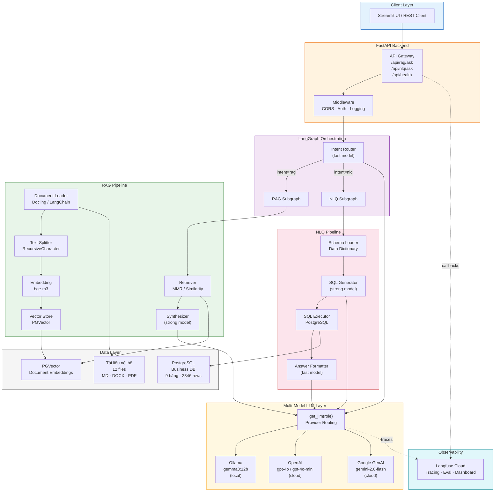
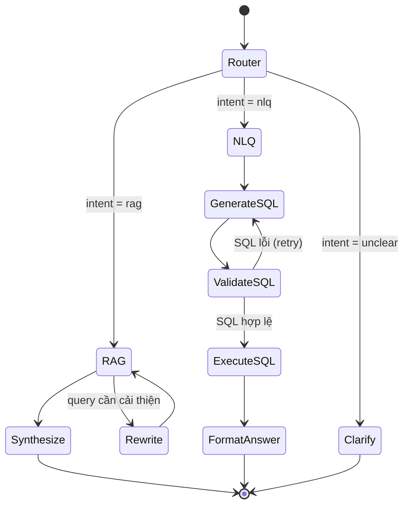
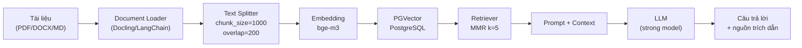
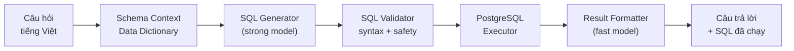
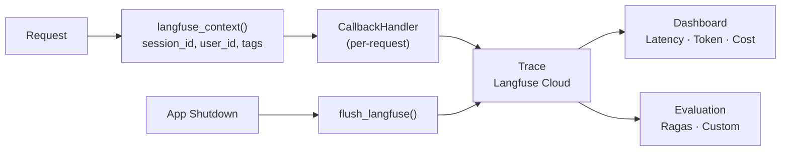
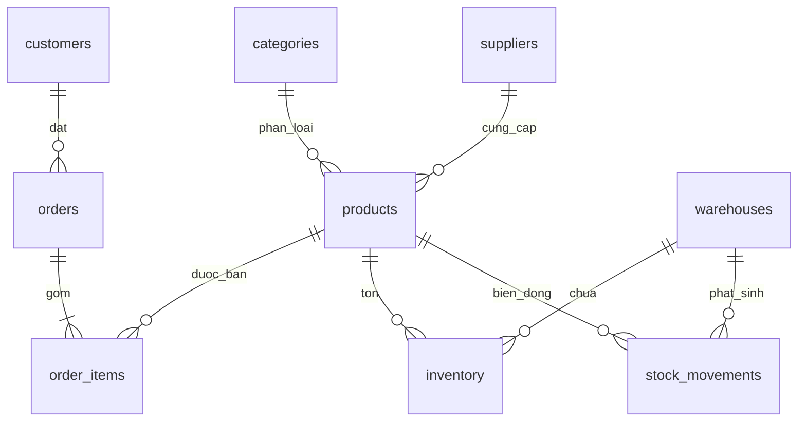
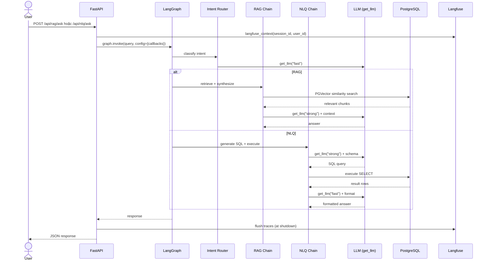

# Kiến trúc hệ thống Mini AI Assistant

> **Phiên bản**: 0.1.0
> **Cập nhật**: 2026-10-22
> **Tác giả**: Trần Quốc Triệu – Intern AI, IOC

## 1. Tổng quan

Mini AI Assistant là hệ thống trợ lý AI nội bộ tích hợp hai chức năng chính:

- **RAG (Retrieval-Augmented Generation)**: Tìm kiếm và trả lời câu hỏi từ tài liệu nội bộ tiếng Việt (PDF/DOCX/MD).
- **NLQ (Natural Language Query)**: Chuyển câu hỏi tự nhiên thành truy vấn SQL trên cơ sở dữ liệu PostgreSQL.

Hệ thống được xây dựng trên FastAPI + LangChain + LangGraph, hỗ trợ đa mô hình (local & cloud), và tích hợp Langfuse để theo dõi chất lượng.

## 2. Sơ đồ kiến trúc tổng thể



## 3. Mô tả các component

### 3.1 API Gateway (FastAPI)

| Endpoint | Mô tả | Trạng thái |
|----------|--------|:----------:|
| `GET /api/health` | Readiness check (Ollama, Langfuse) | ✅ |
| `GET /api/health/live` | Liveness probe | ✅ |
| `GET /api/health/verify-model` | Kiểm tra model (debug only) | ✅ |
| `POST /api/rag/ask` | Hỏi đáp từ tài liệu | 🔜 Tuần 2 |
| `POST /api/nlq/ask` | Hỏi đáp từ database | 🔜 Tuần 2 |

**Lifespan**: Khởi tạo tracing → kiểm tra Ollama async → flush traces khi shutdown.

### 3.2 Multi-Model LLM (`app/core/llm.py`)

```
┌─────────────────────────────────────────────────┐
│  get_llm(role, temperature, timeout, **kwargs)  │
├─────────────────────────────────────────────────┤
│  1. _resolve_model_name(role)                   │
│     "strong" → "openai/gpt-4o"                  │
│     "fast"   → "openai/gpt-4o-mini"             │
│     "local"  → "ollama/gemma3:12b"              │
│  2. _parse_provider_and_model(model_str)        │
│     "ollama/gemma3:12b" → ("ollama","gemma3:12b")│
│  3. Provider-specific kwargs:                    │
│     Ollama  → client_kwargs.timeout              │
│     OpenAI  → timeout, max_retries              │
│  4. init_chat_model(provider, model)            │
│  5. Cache theo (model, temp, timeout, kwargs)   │
└─────────────────────────────────────────────────┘
```

**Chiến lược model theo role**:

| Role | Mục đích | Model mặc định | Ghi chú |
|------|----------|-----------------|---------|
| `local` | Dữ liệu nhạy cảm, offline | `ollama/gemma3:12b` | ~6 tok/s trên CPU |
| `fast` | Router, rewrite, format | `openai/gpt-4o-mini` | Phản hồi nhanh, chi phí thấp |
| `strong` | SQL phức tạp, synthesize | `openai/gpt-4o` | Chất lượng cao nhất |

### 3.3 LangGraph Orchestration (Tuần 2)



**Nguyên tắc gắn tracing vào LangGraph**:
- Handler gắn ở cấp `graph.invoke(..., config={"callbacks": [handler]})`, không gắn từng LLM
- Mỗi request tạo handler riêng (tránh lẫn session khi concurrent)
- Đặt tên node và tag theo role (`router`, `sql_gen`, `synthesize`)

### 3.4 RAG Pipeline



### 3.5 NLQ Pipeline



**An toàn SQL**: Chỉ cho phép SELECT, cấm DROP/DELETE/UPDATE/INSERT. Giới hạn LIMIT mặc định.

### 3.6 Langfuse Observability (`app/core/tracing.py`)



**Thiết kế an toàn**:
- `is_langfuse_configured()` kiểm tra key trước khi tạo handler → app vẫn chạy khi thiếu key
- `init_tracing()` gọi tường minh trong lifespan, không phụ thuộc thứ tự import
- `langfuse_context()` chỉ bọc phần init trong try, yield ngoài → không che lỗi gốc

### 3.7 Data Layer

#### Tài liệu nội bộ (12 files)
- **Chủ đề**: Quy chế công ty giả lập "Sao Việt" (làm việc, bảo mật, lương, đổi trả, bảo hành, vận chuyển, khuyến mãi, nhập/xuất kho, đơn hàng, FAQ)
- **Định dạng**: 6 Markdown + 3 DOCX + 3 PDF
- **Vị trí**: `data/demo_sales_warehouse/`

#### Cơ sở dữ liệu PostgreSQL



| Bảng | Số dòng | Mô tả |
|------|---------|-------|
| categories | 8 | Danh mục sản phẩm |
| suppliers | 15 | Nhà cung cấp |
| products | 80 | Sản phẩm (SKU, giá, trạng thái) |
| customers | 200 | Khách hàng (hạng thành viên, tỉnh/thành) |
| warehouses | 3 | Kho hàng |
| orders | 300 | Đơn hàng (trạng thái, phí giao) |
| order_items | 900 | Chi tiết đơn (số lượng, giá) |
| inventory | 240 | Tồn kho hiện tại |
| stock_movements | 600 | Biến động kho (nhập/xuất/điều chỉnh) |
| **Tổng** | **~2.346** | |

## 4. Công nghệ sử dụng

| Layer | Công nghệ | Phiên bản |
|-------|-----------|-----------|
| Backend | FastAPI + Uvicorn | 0.115+ |
| Orchestration | LangChain + LangGraph | 0.3+ |
| LLM Local | Ollama (gemma3:12b) | latest |
| LLM Cloud | OpenAI API, Google GenAI | gpt-4o, gemini-2.0-flash |
| Embedding | bge-m3 (BAAI) | – |
| Vector DB | PostgreSQL + pgvector | 16+ |
| Tracing | Langfuse Cloud | v5+ |
| Testing | pytest + pytest-asyncio | 9.1+ |
| Frontend (dự kiến) | Streamlit | 1.38+ |

## 5. Cấu trúc thư mục

```
ai-assistant/
├── app/
│   ├── main.py              # FastAPI entrypoint, lifespan
│   ├── api/
│   │   └── health.py        # Health check endpoints
│   ├── core/
│   │   ├── config.py        # Pydantic Settings (.env)
│   │   ├── llm.py           # Multi-model LLM factory
│   │   └── tracing.py       # Langfuse integration
│   └── schemas/             # Pydantic request/response models
├── data/
│   ├── demo_sales_warehouse/
│   │   ├── 01-12_*.md|docx|pdf  # 12 tài liệu tiếng Việt
│   │   ├── schema_seed.sql       # 9 bảng, ~2346 rows
│   │   └── data_dictionary.md    # Từ điển dữ liệu + ERD
│   └── documents/                # Bộ tài liệu phụ (7 files MD)
├── docs/
│   ├── architecture.md           # (file này)
│   ├── benchmark_results.md      # Kết quả benchmark LLM
│   └── benchmark_runs/           # CSV exports
├── scripts/
│   └── compare_models.py         # Script benchmark
├── tests/
│   ├── test_health.py            # 4 tests (mocked)
│   ├── test_llm.py               # 13 tests
│   └── test_tracing.py           # 7 tests
├── .env.example
├── .gitignore
├── pytest.ini
├── requirements.txt
└── README.md
```

## 6. Luồng xử lý request (dự kiến)



## 7. Quyết định thiết kế quan trọng

1. **Tại sao LangGraph thay vì chain đơn giản?**
   - Cần router giữa RAG và NLQ
   - NLQ cần retry loop khi SQL lỗi
   - RAG có thể cần rewrite query
   - Dễ mở rộng thêm tác vụ mới

2. **Tại sao multi-model?**
   - Local model cho dữ liệu nhạy cảm và offline
   - Cloud model cho chất lượng và tốc độ
   - Fallback: `local.with_fallbacks([cloud])` với timeout

3. **Tại sao Langfuse thay vì LangSmith?**
   - Hỗ trợ self-host (tương lai)
   - Tích hợp tốt với LangChain qua CallbackHandler
   - Dashboard đánh giá chất lượng (Ragas integration)

4. **Tại sao PostgreSQL + pgvector?**
   - Một database cho cả business data (NLQ) và vector store (RAG)
   - Giảm complexity vận hành so với dùng Chroma/Pinecone riêng
   - pgvector hỗ trợ HNSW index cho production

## 8. Benchmark sơ bộ (gemma3:12b local)

| Prompt Type | Thời gian | Tokens | Tốc độ |
|-------------|-----------|--------|--------|
| RAG (trả lời ngắn) | 22.19s | ~133 | ~6 tok/s |
| SQL Generation | 81.83s | ~491 | ~6 tok/s |
| Reasoning (dài) | 263.20s | ~1491 | ~5.7 tok/s |

> **Nhận xét**: Tốc độ đều ~6 tok/s cho thấy nhiều khả năng chạy CPU. Cần kiểm tra `ollama ps` và cân nhắc bản quantized nhỏ hơn cho tác vụ nhẹ.

## 9. Rủi ro và giải pháp

| Rủi ro | Giải pháp |
|--------|-----------|
| Local model chậm (CPU-bound) | Streaming SSE, fallback sang cloud, giới hạn max_tokens |
| SQL injection từ NLQ | Chỉ cho phép SELECT, validate trước khi execute, LIMIT mặc định |
| Concurrent requests lẫn trace | Handler per-request, propagate_attributes dùng contextvars |
| Tài liệu tiếng Việt chunk sai | Tùy chỉnh text splitter cho tiếng Việt, test với bộ golden set |
| PostgreSQL chưa cài | Dùng Docker Compose hoặc cài native cho dev |
