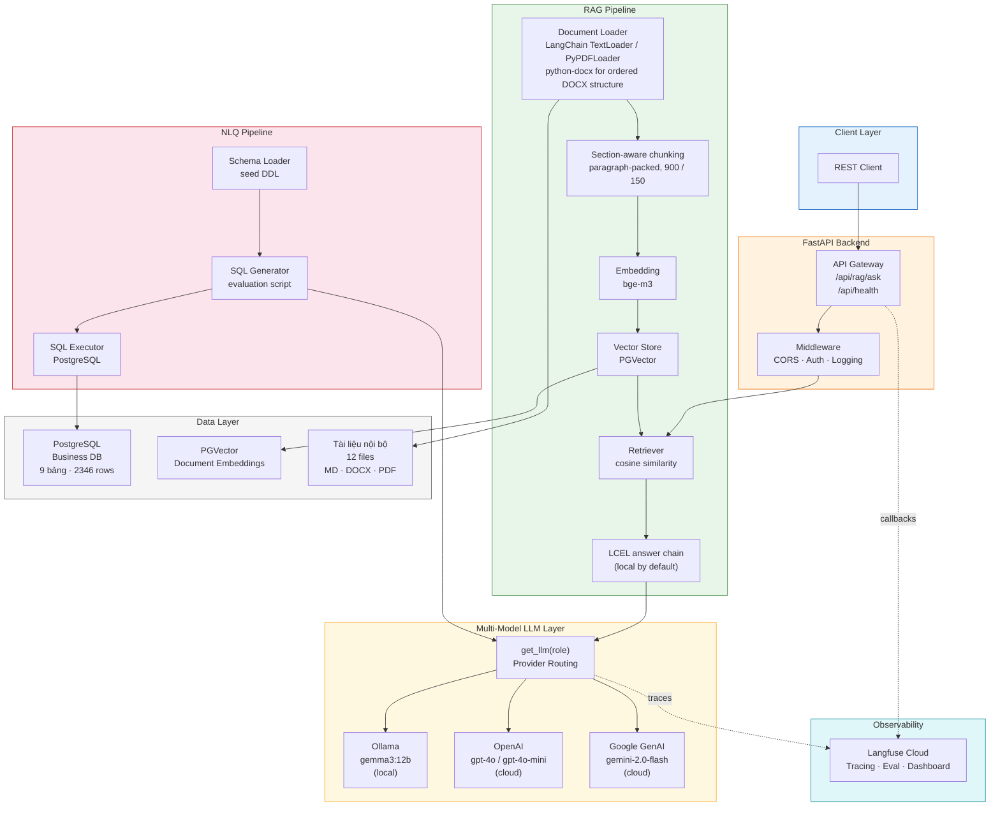
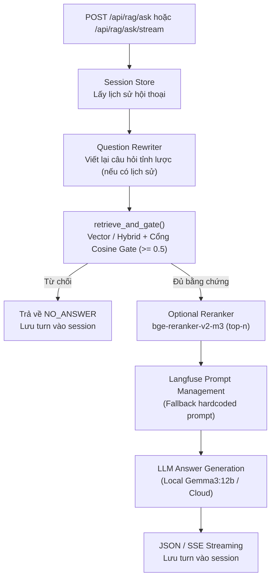
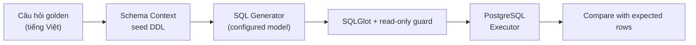
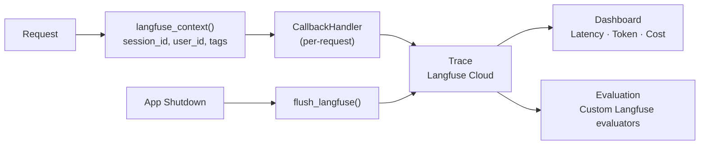
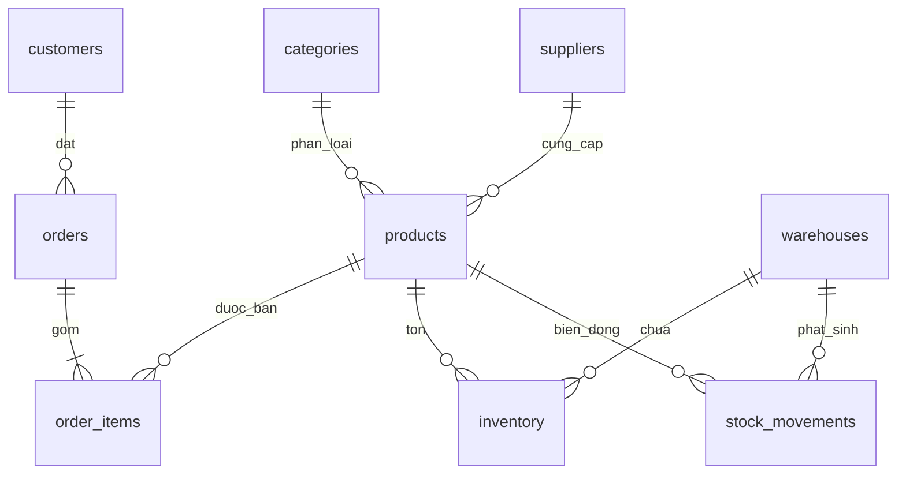
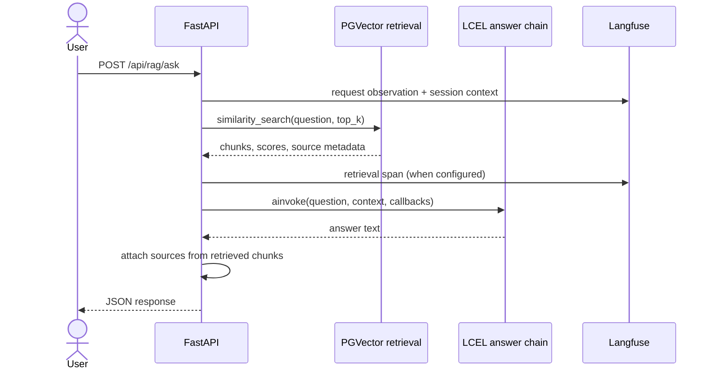

# Kiến trúc hệ thống Mini AI Assistant

> **Phiên bản**: 0.2.0
> **Cập nhật**: 2026-10-24
> **Tác giả**: Trần Quốc Triệu – Intern AI, IOC

## 1. Tổng quan

Mini AI Assistant hiện có API hỏi đáp RAG và các script đánh giá NLQ:

- **RAG (Retrieval-Augmented Generation)**: Tìm kiếm và trả lời câu hỏi từ tài liệu nội bộ tiếng Việt (PDF/DOCX/MD/TXT).
- **NLQ (Natural Language Query)**: Chuyển câu hỏi tự nhiên thành truy vấn SQL trên cơ sở dữ liệu PostgreSQL.

API được xây dựng trên FastAPI + LangChain, hỗ trợ đa mô hình (local & cloud), và tích hợp Langfuse tracing tùy cấu hình. NLQ hiện là evaluator offline; chưa có endpoint NLQ trong API. LangGraph chưa được dùng trong luồng runtime hiện tại.

## 2. Sơ đồ kiến trúc tổng thể



## 3. Mô tả các component

### 3.1 API Gateway (FastAPI)

| Endpoint | Mô tả | Trạng thái |
|----------|--------|:----------:|
| `GET /api/health` | Readiness check (Ollama, Langfuse) | ✅ |
| `GET /api/health/live` | Liveness probe | ✅ |
| `GET /api/health/verify-model` | Kiểm tra model (debug only, cần API key) | ✅ |
| `POST /api/rag/ask` | Hỏi đáp từ tài liệu (JSON response) | ✅ |
| `POST /api/rag/ask/stream` | Hỏi đáp tài liệu dạng streaming Server-Sent Events (SSE) | ✅ |

**Lifespan**: Khởi tạo tracing → kiểm tra Ollama async → flush traces khi shutdown.

Các endpoint RAG và kiểm tra model yêu cầu `X-API-Key`; `/api/health` và `/api/health/live` công khai. API được giới hạn mặc định 60 request/phút theo IP bằng bộ đếm trong tiến trình. Cấu hình nhiều worker/reverse proxy cần giới hạn ở proxy hoặc shared store.

### 3.2 Multi-Model LLM (`app/core/llm.py`)

```
┌─────────────────────────────────────────────────┐
│  get_llm(role, temperature, timeout, **kwargs)  │
├─────────────────────────────────────────────────┤
│  1. _resolve_model_name(role)                   │
│     "strong" → "openai/gpt-4o"                  │
│     "fast"   → "openai/gpt-4o-mini"             │
│     "local"  → "ollama/gemma3:12b"              │
│  2. _parse_provider_and_model(model_str)        │
│     "ollama/gemma3:12b" → ("ollama","gemma3:12b")│
│  3. Provider-specific kwargs:                    │
│     Ollama  → client_kwargs.timeout              │
│     OpenAI  → timeout, max_retries              │
│  4. init_chat_model(provider, model)            │
│  5. Cache theo (model, temp, timeout, kwargs)   │
└─────────────────────────────────────────────────┘
```

**Chiến lược model theo role**:

| Role | Mục đích | Model mặc định | Ghi chú |
|------|----------|-----------------|---------|
| `local` | Dữ liệu nhạy cảm, offline | `ollama/gemma3:12b` | ~6 tok/s trên CPU |
| `fast` | Router, rewrite, format | `openai/gpt-4o-mini` | Phản hồi nhanh, chi phí thấp |
| `strong` | SQL phức tạp, synthesize | `openai/gpt-4o` | Chất lượng cao nhất |

### 3.3 Request flow, Tracing & Streaming



`/api/rag/ask` hỗ trợ trả về JSON có cấu trúc (`RagAskResponse`), trong khi `/api/rag/ask/stream` hỗ trợ Server-Sent Events (SSE) trả về từng token (`text/event-stream`). Cả 2 endpoint đều đi qua cổng ngữ cảnh (`session_store`), viết lại câu hỏi phụ thuộc ngữ cảnh (`question_rewriter`), và cổng retrieval (`retrieve_and_gate`). Khi điểm tương đồng cosine cao nhất dưới ngưỡng (`0.5`), hệ thống lập tức từ chối mà không gọi LLM suy luận, bảo đảm tiết kiệm tài nguyên và phòng tránh hallucination.

### 3.4 RAG Pipeline & Retrieval Abstraction

Pipeline retrieval có một đường thực thi tại `app/core/retriever.py`:

1. **Vector**: truy vấn cosine trên PGVector bằng `bge-m3`.
2. **Hybrid**: trộn danh sách BM25 và vector bằng weighted Reciprocal Rank Fusion. Token BM25 chuẩn hóa Unicode và chữ hoa/thường; mỗi chunk được định danh bằng cặp `(source, chunk_index)` để không gộp các đoạn trùng chữ từ hai file.
3. **Cosine gate**: chấm cosine cho từng chunk sau fusion và chỉ đưa chunk vượt `RAG_MIN_RELEVANCE_SCORE` vào context. Truy vấn hybrid tái sử dụng cùng một embedding câu hỏi cho cả truy vấn vector và chấm các chunk BM25-only.
4. **Reranker**: khi bật, cùng hàm `rerank_documents` chạy `sentence-transformers` với model lấy từ `RERANKER_MODEL`. Cài tùy chọn nặng bằng `pip install -r requirements-reranker.txt`; startup kiểm tra dependency khi tính năng được bật.
5. **Langfuse Prompt Management**: tải prompt dạng chat, chuyển danh sách message thành `ChatPromptTemplate`, dùng client SDK dùng chung để tái sử dụng prompt cache và truyền fallback hardcoded cho lần tải đầu. Các script đánh giá dùng prompt đã chốt trong repo và ghi nguồn prompt trong artifact.

Lịch sử hội thoại hiện lưu trong bộ nhớ của một tiến trình, giữ tối đa 20 lượt gần nhất mỗi phiên và tối đa 1.000 phiên. Dùng một worker; nhiều worker hoặc khởi động lại sẽ không chia sẻ/giữ lịch sử, nên cần PostgreSQL/Redis store nếu triển khai nhiều tiến trình.


### 3.5 NLQ model evaluator (offline)



This is an offline evaluation script, not an API pipeline. It accepts one SELECT/WITH statement, executes it in a read-only transaction with a timeout, and compares rows with the golden set. There is no NLQ endpoint or answer formatter in the current app.

### 3.6 Langfuse Observability (`app/core/tracing.py`)



**Thiết kế an toàn**:
- `is_langfuse_configured()` kiểm tra key trước khi tạo handler → app vẫn chạy khi thiếu key
- `init_tracing()` gọi tường minh trong lifespan, không phụ thuộc thứ tự import
- `langfuse_context()` chỉ bọc phần init trong try, yield ngoài → không che lỗi gốc

### 3.7 Data Layer

#### Tài liệu nội bộ (12 files)
- **Chủ đề**: Quy chế công ty giả lập "Sao Việt" (làm việc, bảo mật, lương, đổi trả, bảo hành, vận chuyển, khuyến mãi, nhập/xuất kho, đơn hàng, FAQ)
- **Định dạng**: 6 Markdown + 3 DOCX + 3 PDF
- **Vị trí**: `data/demo_sales_warehouse/`

#### Cơ sở dữ liệu PostgreSQL



| Bảng | Số dòng | Mô tả |
|------|---------|-------|
| categories | 8 | Danh mục sản phẩm |
| suppliers | 15 | Nhà cung cấp |
| products | 80 | Sản phẩm (SKU, giá, trạng thái) |
| customers | 200 | Khách hàng (hạng thành viên, tỉnh/thành) |
| warehouses | 3 | Kho hàng |
| orders | 300 | Đơn hàng (trạng thái, phí giao) |
| order_items | 900 | Chi tiết đơn (số lượng, giá) |
| inventory | 240 | Tồn kho hiện tại |
| stock_movements | 600 | Biến động kho (nhập/xuất/điều chỉnh) |
| **Tổng** | **~2.346** | |

## 4. Công nghệ sử dụng

| Layer | Công nghệ | Phiên bản |
|-------|-----------|-----------|
| Backend | FastAPI + Uvicorn | 0.115+ |
| Orchestration | Direct FastAPI flow + LangChain LCEL & retrievers | 1.4.7+ |
| LLM Local | Ollama (gemma3:12b) | latest |
| LLM Cloud | OpenAI API, Google GenAI | gpt-4o, gemini-2.0-flash |
| Embedding | bge-m3 (BAAI) | 1024-dim |
| Hybrid Retrieval | rank-bm25 + PGVector (EnsembleRetriever RRF) | 0.2.2 |
| Reranker | BAAI/bge-reranker-v2-m3 (sentence-transformers) | 6.2.0 |
| Vector DB | PostgreSQL + pgvector | 16+ |
| Tracing & Prompts | Langfuse Cloud | v5+ |
| Testing | pytest + pytest-asyncio | 9.1+ |
| Frontend (dự kiến) | Streamlit | 1.38+ |

## 5. Cấu trúc thư mục

```
ai-assistant/
├── app/
│   ├── main.py              # FastAPI entrypoint, lifespan
│   ├── api/
│   │   ├── health.py        # Health check endpoints
│   │   └── rag.py           # POST /api/rag/ask & /api/rag/ask/stream
│   ├── core/
│   │   ├── config.py        # Pydantic Settings (.env)
│   │   ├── llm.py           # Multi-model LLM factory
│   │   ├── retriever.py     # Unified retrieval (Vector, Hybrid, Gate)
│   │   ├── reranker.py      # Cross-encoder reranker
│   │   ├── session_store.py # Multi-turn conversational memory
│   │   ├── question_rewriter.py # Context-aware question rewriter
│   │   ├── rag_prompt.py    # Langfuse Prompt Management & hardcoded prompt
│   │   ├── security.py      # API key validation & rate limiting
│   │   ├── tracing.py       # Langfuse integration
│   │   └── vector_store.py  # PGVector database client
│   └── schemas/             # Pydantic request/response models
├── data/
│   ├── demo_sales_warehouse/ # 12 tài liệu nghiệp vụ
│   ├── conversation_dev_set.json # 10 kịch bản test hội thoại
│   ├── rag_golden_set.json  # 65 test cases đánh giá RAG
│   └── nlq_golden_set.json  # 30 test cases NLQ
├── eval/
│   ├── baseline_v5_65cases.json
│   ├── hybrid_vs_vector_comparison.md
│   ├── hybrid_vs_vector_comparison.json
│   ├── rerank_config_comparison.md
│   ├── rerank_config_comparison.json
│   └── conversation_dev_evaluation.md
├── docs/
│   ├── architecture.md      # (file này)
│   ├── benchmark_results.md # Kết quả benchmark LLM
│   └── rag_evaluation_v1.md
├── scripts/
│   ├── evaluate_hybrid_vs_vector.py # Thực nghiệm AI09
│   ├── evaluate_rerank_configs.py   # Thực nghiệm AI10
│   ├── evaluate_chat_history.py     # Thực nghiệm AI11
│   ├── validate_golden_data.py
│   └── ingest_documents.py
├── tests/                   # 115 unit & integration tests
├── .env.example
├── requirements.lock
├── requirements-reranker.txt # Sentence-transformers/Torch (optional)
└── README.md
```

## 6. Luồng xử lý hiện tại



## 7. Quyết định thiết kế quan trọng

1. **Workflow hiện tại**
   - RAG là luồng trực tiếp trong FastAPI; LCEL chain kết hợp `ChatPromptTemplate`, chat model và Pydantic output parser.
   - NLQ model evaluation là script offline dùng seed DDL và read-only SQL.
   - LangGraph và NLQ API chưa được triển khai.

2. **Tại sao multi-model?**
   - Local model cho dữ liệu nhạy cảm và offline
   - Cloud model cho chất lượng và tốc độ
   - Fallback: `local.with_fallbacks([cloud])` với timeout

3. **Tại sao Langfuse thay vì LangSmith?**
   - Hỗ trợ self-host (tương lai)
   - Tích hợp tốt với LangChain qua CallbackHandler
   - Dashboard trace; evaluator hiện tại là custom LLM-as-a-judge, không phải Ragas.

4. **Tại sao PostgreSQL + pgvector?**
   - Một database cho cả business data (NLQ) và vector store (RAG)
   - Giảm complexity vận hành so với dùng Chroma/Pinecone riêng
   - pgvector hỗ trợ HNSW index cho production

## 8. Benchmark sơ bộ (gemma3:12b local)

| Prompt Type | Thời gian | Tokens | Tốc độ |
|-------------|-----------|--------|--------|
| RAG (trả lời ngắn) | 22.19s | ~133 | ~6 tok/s |
| SQL Generation | 81.83s | ~491 | ~6 tok/s |
| Reasoning (dài) | 263.20s | ~1491 | ~5.7 tok/s |

> **Nhận xét**: Tốc độ đều ~6 tok/s cho thấy nhiều khả năng chạy CPU. Cần kiểm tra `ollama ps` và cân nhắc bản quantized nhỏ hơn cho tác vụ nhẹ.

## 9. Rủi ro và giải pháp

| Rủi ro | Giải pháp |
|--------|-----------|
| Local model chậm (CPU-bound) | Streaming SSE, fallback sang cloud, giới hạn max_tokens |
| SQL injection từ NLQ | Chỉ cho phép SELECT, validate trước khi execute, LIMIT mặc định |
| Concurrent requests lẫn trace | Handler per-request, propagate_attributes dùng contextvars |
| Tài liệu tiếng Việt chunk sai | Tùy chỉnh text splitter cho tiếng Việt, test với bộ golden set |
| PostgreSQL chưa cài | Dùng Docker Compose hoặc cài native cho dev |
