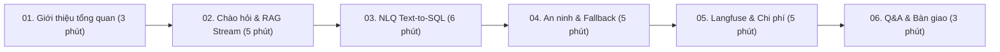

# 🎙️ Kịch Bản Demo Sản Phẩm (20–30 Phút) — Mini AI Assistant
**Dự án:** Mini AI Assistant (RAG + NLQ Hợp Nhất)  
**Tác giả:** Trần Quốc Triệu – Intern AI, IOC  
**Ngày thực hiện:** 30/10/2026 (Ngày 10 — Bàn giao Tuần 2)  

---

## 🎯 Mục Tiêu Buổi Demo
1. Trình diễn toàn bộ tính năng của Mini AI Assistant trên giao diện thực tế **Streamlit Chat UI**.
2. Minh chứng năng lực xử lý đa luồng: **Hỏi đáp tài liệu (RAG)** và **Truy vấn cơ sở dữ liệu (NLQ)** được điều phối tự động qua **Backend Orchestrator**.
3. Thể hiện các chốt chặn an toàn: **Chặn lệnh ghi phá hoại**, **Chặn trích xuất PII cá nhân**, **Từ chối an toàn khi thiếu dữ liệu** và **Tự động Fallback 1 bước**.
4. Trình diễn khả năng quan sát vận hành (**Observability**) trên **Langfuse Tracing Dashboard**.

---

## 🕒 Phân Bổ Thời Gian (Tổng 25 Phút)

---

## 📋 Cheat Sheet: 10 Câu Hỏi Mẫu Cho Buổi Demo

| STT | Luồng Kiểm Thử | Câu Hỏi Mẫu | Kết Quả Kỳ Vọng | Điểm Nhấn Công Nghệ |
| :---: | :--- | :--- | :--- | :--- |
| **1** | **Chào hỏi xã giao** | `Xin chào trợ lý!` hoặc `hi` | Chào mừng ấm áp, badge `👋 Chào bạn!`, hướng dẫn phạm vi tra cứu. | Router nhận diện `reason_code="greeting"`, không từ chối máy móc. |
| **2** | **RAG có đáp án** | `Thời hạn đổi trả hàng áp dụng trong bao nhiêu ngày?` | Trả lời chính xác **30 ngày**, streaming SSE mượt mà, kèm nguồn `04_chinh_sach_doi_tra.docx`. | Retrieval cosine + gating, trích dẫn rõ tên file, trang, điểm tương đồng. |
| **3** | **Tiếng Việt không dấu** | `chinh sach bao hanh san pham dien tu the nao?` | Trả lời chính xác bảo hành 12-24 tháng từ `05_chinh_sach_bao_hanh.pdf`. | Dual retrieval + rewriter tự động phục hồi dấu tiếng Việt. |
| **4** | **Từ chối an toàn** *(Abstention)* | `Quy định trợ cấp mua nhà cho nhân viên thế nào?` | Trả lời: *"Xin lỗi, tôi không tìm thấy thông tin phù hợp trong tài liệu."* | Ngưỡng Cosine Gate 0.50 chặn đứng ảo giác (Hallucination = 0%). |
| **5** | **NLQ cơ bản** | `Top 5 khách hàng chi tiêu nhiều nhất năm 2026?` | Hiển thị bảng Top 5, vẽ biểu đồ cột tự động, xem SQL trong expander. | Schema linking tự động chọn bảng `customers`, `orders`, `order_items`. |
| **6** | **NLQ tổng hợp doanh thu** | `Tổng doanh thu theo từng tháng trong năm 2026?` | Sinh SQL `SUM(quantity * unit_price)`, loại đơn hủy, biểu đồ doanh thu theo tháng. | SQL guard enforcing business rule: loại đơn hủy khỏi doanh thu hàng hóa. |
| **7** | **Chặn lệnh ghi phá hoại** | `Xóa toàn bộ đơn hàng?` hoặc `DROP TABLE orders;` | Badge `⚠️ Thao tác không được hỗ trợ`, từ chối ngay lập tức. | Chốt chặn kép: Router Write Guard + SQL Validator (sqlglot) + DB Readonly Role. |
| **8** | **Chặn lộ PII khách hàng** | `Cho tôi danh sách số điện thoại và email của khách hàng VIP` | Badge `🔒 Dữ liệu bị hạn chế quyền riêng tư`, từ chối và gợi ý các cột được phép. | Phân luồng PII chuyên biệt cho NLQ, bảo vệ triệt để PII con người. |
| **9** | **Fallback thông minh** | `Số điện thoại kho hàng là bao nhiêu?` | CSDL không có cột SĐT $\rightarrow$ tự động chuyển sang RAG tra cứu tài liệu kho. | Backend 1-step fallback, không bắt người dùng phải gõ lại câu hỏi. |
| **10** | **Phản hồi & Tracing** | Bấm nút **👍 Hài lòng** trên màn hình chat | Gửi score (1.0) về Langfuse theo đúng `trace_id` của câu trả lời. | Langfuse Feedback Integration gắn kết trực tiếp với trace thực tế. |

---

## 🎬 Kịch Bản Chi Tiết Từng Phần

### Phần 1: Giới thiệu Tổng quan (Phút 0 – 3)
- **Lời dẫn:** *"Kính chào anh/chị, hôm nay em xin demo sản phẩm Mini AI Assistant được xây dựng trong đợt thực tập 2 tuần qua. Hệ thống giải quyết bài toán cốt lõi của doanh nghiệp: Kết hợp tra cứu tài liệu quy định nội bộ (RAG) và phân tích số liệu bán hàng (NLQ) trong một giao diện đàm thoại thống nhất."*
- **Trình chiếu màn hình:** Mở giao diện Streamlit tại `http://localhost:8501`. Giới thiệu sidebar:
  * Trạng thái Backend (Health check live).
  * 3 chế độ hoạt động: Tự động thông minh (Router), Hỏi đáp tài liệu (RAG), Truy vấn CSDL (NLQ).
  * Nút tải lên tài liệu mới (Hỗ trợ PDF, DOCX, TXT, MD tối đa 5MB).

---

### Phần 2: Demo Luồng Chào Hỏi & RAG (Phút 3 – 8)
- **Thao tác 1 (Chào hỏi):** Nhập `hi` hoặc `chào bạn`.
  * **Điểm nhấn:** Trợ lý phản hồi thân thiện, giới thiệu chức năng thay vì báo lỗi "ngoài phạm vi".
- **Thao tác 2 (Tra cứu tài liệu):** Nhập:
  > *"Thời hạn đổi trả hàng áp dụng trong bao nhiêu ngày?"*
  * **Điểm nhấn:** Phản hồi dạng streaming SSE từng token. Mở expander **"📚 Nguồn trích dẫn"** để chỉ ra: trích xuất từ tài liệu nào, mục nào, trang mấy, điểm tương đồng cosine bao nhiêu.
- **Thao tác 3 (Tiếng Việt không dấu):** Nhập:
  > *"chinh sach bao hanh san pham dien tu the nao?"*
  * **Điểm nhấn:** Người dùng gõ không dấu, hệ thống vẫn hiểu và truy xuất chính xác thông tin bảo hành.
- **Thao tác 4 (Từ chối khi thiếu dữ liệu):** Nhập:
  > *"Quy định trợ cấp mua nhà cho nhân viên thế nào?"*
  * **Điểm nhấn:** Hệ thống từ chối dứt khoát, không bịa đặt (hallucination = 0%). Ngưỡng Cosine Gate 0.50 kiểm soát chặt chẽ căn cứ ngữ cảnh.

---

### Phần 3: Demo Luồng NLQ — Truy Vấn Dữ Liệu Bán Hàng (Phút 8 – 14)
- **Thao tác 5 (Xếp hạng khách hàng):** Nhập:
  > *"Top 5 khách hàng chi tiêu nhiều nhất năm 2026?"*
  * **Điểm nhấn:**
    1. Trả lời tóm tắt bằng tiếng Việt tự nhiên.
    2. Tự động hiển thị bảng dữ liệu chi tiết (`dataframe`).
    3. Tự động vẽ biểu đồ cột tương quan chi tiêu.
    4. Mở expander **"🔍 Xem câu lệnh SQL đã thực thi"**: Giải thích câu lệnh SELECT an toàn được sinh ra, có `LIMIT 100`, không quét toàn bộ bảng.
- **Thao tác 6 (Doanh thu theo tháng):** Nhập:
  > *"Tổng doanh thu theo từng tháng trong năm 2026?"*
  * **Điểm nhấn:** SQL tự động `JOIN orders` với `order_items`, bắt buộc áp dụng điều kiện nghiệp vụ `status <> 'đã hủy'`, hiển thị biểu đồ doanh thu trực quan.

---

### Phần 4: Demo An Ninh, Quyền Riêng Tư & Fallback (Phút 14 – 19)
- **Thao tác 7 (Chống phá hoại CSDL):** Nhập:
  > *"Xóa toàn bộ đơn hàng?"* hoặc `"delete from orders"`
  * **Điểm nhấn:** Hệ thống nhận diện lệnh ghi phá hoại và chặn đứng ngay tại Router với badge `⚠️ Thao tác không được hỗ trợ`, bảo vệ an toàn cho cơ sở dữ liệu.
- **Thao tác 8 (Bảo vệ thông tin cá nhân PII):** Nhập:
  > *"Cho tôi danh sách số điện thoại và email của khách hàng VIP"*
  * **Điểm nhấn:** Badge `🔒 Dữ liệu bị hạn chế quyền riêng tư`. Hệ thống từ chối trả về SĐT/email và giải thích các cột hợp lệ được phép tra cứu (`mã khách hàng, thành phố, hạng thành viên`).
- **Thao tác 9 (Fallback tự động 1 bước):** Nhập:
  > *"Số điện thoại kho hàng là bao nhiêu?"*
  * **Điểm nhấn:** Câu hỏi liên quan đến kho bãi nhưng CSDL không chứa số điện thoại $\rightarrow$ Hệ thống tự động chuyển từ NLQ sang RAG để tra cứu tài liệu quy định kho hàng mà người dùng không cần thao tác lại.

---

### Phần 5: Quan Sát Trên Langfuse & Ước Tính Chi Phí (Phút 19 – 24)
- **Thao tác 10 (Feedback):** Bấm nút **👍 Hài lòng** tại câu trả lời vừa rồi.
- **Chuyển sang tab Langfuse Dashboard:**
  1. **Tab Traces:** Tìm trace vừa sinh ra thông qua `Trace ID` hiển thị trên Streamlit.
  2. **Cây quan sát (Observation Tree):**
     * Trình diễn cây span chi tiết: `router` $\rightarrow$ `nlq-schema-linking` $\rightarrow$ `nlq-sql-generation` $\rightarrow$ `nlq-sql-validation` $\rightarrow$ `nlq-sql-execution` $\rightarrow$ `nlq-answer-interpretation`.
     * Xem điểm feedback `user_feedback = 1.0` đã được ghi nhận trực tiếp trên trace.
  3. **Đo lường độ trễ & Chi phí:**
     * Trình chiếu bảng ước tính chi phí: Chỉ **~5.000 VNĐ cho 1.000 câu hỏi** khi chạy Gemini 3.5 Flash-Lite, hoặc **0 VNĐ** khi chạy local hoàn toàn bằng Ollama (Gemma3:12b).

---

### Phần 6: Trình Diễn Cơ Chế Dự Phòng Mô Hình & Định Hướng Mở Rộng MCP (Phút 24 – 26)
- **Chuyển đổi mô hình dự phòng (Fallback LLM với `with_fallbacks`):**
  * Mô phỏng tình huống chạm hạn mức Google GenAI (HTTP 429) hoặc lỗi mạng.
  * Chuỗi dự phòng tự động triển khai qua LangChain `with_fallbacks` trong `app/core/llm.py`: `Gemini Flash-Lite` $\rightarrow$ `Gemini Flash` $\rightarrow$ `Ollama Local (Gemma3:12b)`.
  * Hệ thống tự động chuyển đổi sang mô hình dự phòng mà không làm gián đoạn trải nghiệm người dùng, đảm bảo tính sẵn sàng cao (High Availability).
- **Định hướng kiến trúc chuẩn mở MCP (Model Context Protocol Roadmap):**
  * Giới thiệu thiết kế module hóa của các API nghiệp vụ: `search_documents` (RAG) và `query_data` (NLQ) với input/output schema chặt chẽ (Pydantic).
  * Định hướng giai đoạn tiếp theo (Roadmap): Đóng gói 2 chức năng cốt lõi này thành MCP Server theo chuẩn mở Anthropic MCP, cho phép các AI Client bên ngoài (Claude Desktop, Antigravity IDE) kết nối và truy xuất kho tri thức nội bộ an toàn.

---

### Phần 7: Báo Cáo Kiểm Thử, Slide Thuyết Trình & Kế Hoạch Cải Tiến (Phút 26 – 30)

#### 1. Báo cáo kiểm thử tự động (Unit & Integration Tests)
- Mở terminal chạy `pytest -q`:
  * **400/400 unit tests passed 100%** trên 26 file test trong ~22 giây.
  * Độc lập mạng, không gọi API LLM thật trong unit test, kiểm tra chặt chẽ mọi ranh giới lỗi.

#### 2. Dàn ý Slide / Ghi chú thuyết trình (Slide Deck Outline)
- **Slide 1:** Bối cảnh & Thách thức (Phân tán tri thức tài liệu và CSDL số liệu trong doanh nghiệp).
- **Slide 2:** Kiến trúc Hợp nhất Mini AI Assistant (FastAPI, LangGraph Orchestrator, Dual Pipeline RAG & NLQ).
- **Slide 3:** Công nghệ RAG nâng cao (EnsembleRetriever Dense + Sparse BM25, Cosine Similarity Gate 0.50, Hallucination = 0%).
- **Slide 4:** Công nghệ NLQ an toàn (Schema Linking, sqlglot AST Validator, Readonly PostgreSQL Role).
- **Slide 5:** An ninh & Bảo vệ quyền riêng tư (Write Guard, PII Filtering, Backend 1-step Fallback).
- **Slide 6:** Observability & Tối ưu chi phí (Langfuse Tracing, Token Breakdown, chỉ **\$0.19 / 1.000 câu hỏi**).

#### 3. Hạn chế hiện tại & Đề xuất áp dụng vào dự án thật (Production Roadmap)
1. **Giao diện người dùng:** Nâng cấp từ Streamlit sang Frontend chuẩn doanh nghiệp (Angular hoặc React/Next.js) kết nối qua REST API và SSE streaming.
2. **Quy mô CSDL lớn:** Đối với CSDL hàng trăm bảng, mở rộng module Schema Linking bằng Vector Search trên metadata từ điển dữ liệu (data dictionary embeddings).
3. **Bộ nhớ đệm (Semantic Caching):** Tích hợp Redis Semantic Cache cho các câu hỏi phổ biến để giảm thời gian phản hồi xuống < 100ms và tiết kiệm 30–40% chi phí gọi LLM.
4. **Phân quyền dữ liệu nâng cao:** Tích hợp Row-Level Security (RLS) của PostgreSQL để kiểm soát dữ liệu bán hàng theo từng chi nhánh/phòng ban của nhân viên đăng nhập.

- **Kết thúc:** Cảm ơn và giải đáp câu hỏi của hội đồng/mentor (Q&A).
