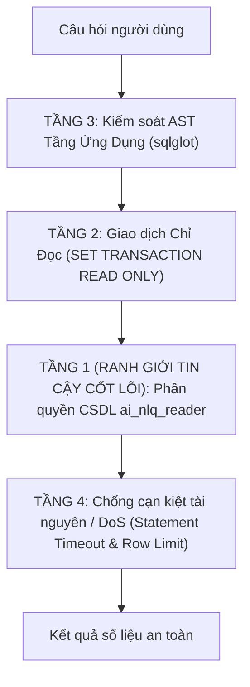

# Mô Hình Đe Dọa Cho Hệ Thống NLQ (Threat Model)

Tài liệu phân tích các nguy cơ bảo mật đối với hệ thống truy vấn CSDL bằng ngôn ngữ tự nhiên (Natural Language Query - Text-to-SQL) và kiến trúc phòng thủ phân tầng (Defense-in-Depth).

---

## 1. Bề Mặt Tấn Công (Attack Vectors)

Hệ thống NLQ tiếp nhận câu hỏi tự nhiên từ người dùng, sử dụng LLM để sinh câu lệnh SQL và thực thi trên PostgreSQL. Các rủi ro an ninh chính gồm:

| Mã rủi ro | Mối đe dọa | Mô tả kịch bản tấn công |
| :--- | :--- | :--- |
| **THREAT-01** | **SQL Injection gián tiếp qua Prompt** | Kẻ tấn công chèn prompt ác ý nhằm ép LLM sinh ra lệnh phá hoại CSDL (`DROP TABLE`, `UPDATE`, `DELETE`). |
| **THREAT-02** | **Thoát dữ liệu nhạy cảm (Data Exfiltration)** | Truy vấn cố ý lấy thông tin cá nhân khách hàng (`email`, `phone`, `full_name`) hoặc bảng tài liệu nội bộ (`rag_chunks`). |
| **THREAT-03** | **Bypass qua CTE Shadowing / Schema ngoại lai** | Định nghĩa CTE trùng tên bảng bị cấm để đánh lừa bộ kiểm tra AST, sau đó `CROSS JOIN` với bảng thật kèm tiền tố schema (`public.rag_chunks`). |
| **THREAT-04** | **Bypass tham chiếu cả dòng qua Alias** | Dùng cú pháp composite row của PostgreSQL (`SELECT c FROM customers c`) để lấy toàn bộ dữ liệu dòng mà không gọi đích danh cột nhạy cảm. |
| **THREAT-05** | **Tấn công từ chối dịch vụ (DoS / Resource Exhaustion)** | Ép LLM sinh truy vấn tích Descartes khổng lồ, quét toàn bộ bảng hoặc gọi các hàm ngắt CPU/Disk (`pg_sleep(60)`). |

---

## 2. Kiến Trúc Phòng Thủ Phân Tầng (Defense-in-Depth)

Hệ thống áp dụng nguyên tắc bảo mật đa tầng, trong đó **quyền hạn CSDL là ranh giới tin cậy cốt lõi**, còn các bộ lọc AST và timeout đóng vai trò lớp bổ trợ giảm thiểu rủi ro sớm:



---

### TẦNG 1: Ranh Giới Tin Cậy Cốt Lõi CSDL (Least Privilege Database Grants)

> [!IMPORTANT]
> Đây là **chốt chặn an ninh quan trọng nhất**. Dù kẻ tấn công có qua mặt được LLM và bộ phân tích cú pháp ở tầng ứng dụng, hạt nhân PostgreSQL vẫn chặn đứng mọi hành vi truy cập trái phép.

Hệ thống NLQ sử dụng tài khoản chuyên dụng `ai_nlq_reader` (`NLQ_DATABASE_URL`), tách biệt hoàn toàn với `DATABASE_URL` chính:

1. **Không có quyền ghi:** Tuyệt đối không cấp quyền `INSERT`, `UPDATE`, `DELETE`, `DROP`, `TRUNCATE`, `ALTER`.
2. **Ẩn hoàn toàn bảng nhạy cảm:**
   ```sql
   REVOKE ALL ON TABLE rag_chunks FROM ai_nlq_reader;
   ```
   Tài khoản NLQ không có quyền `SELECT` trên bảng vector `rag_chunks`.
3. **Phân quyền cấp cột (Column-level Grants) trên bảng Khách hàng:**
   ```sql
   GRANT SELECT (customer_id, city, member_tier, joined_on) ON customers TO ai_nlq_reader;
   ```
   Không cấp quyền trên các cột nhạy cảm `email`, `phone`, `full_name`. Mọi truy vấn cố tình đọc các cột này sẽ bị PostgreSQL từ chối ở cấp CSDL với lỗi `Permission denied`.

---

### TẦNG 2: Giao Dịch Chỉ Đọc (Read-Only Transaction)

Trước khi thực thi bất kỳ câu SQL nào, kết nối luôn thiết lập chế độ chỉ đọc:

```sql
SET TRANSACTION READ ONLY;
```

Ngăn chặn triệt để mọi hành vi ghi dữ liệu hoặc sửa đổi tham số hệ thống ngay cả khi có lệnh lọt qua.

---

### TẦNG 3: Kiểm Soát Cú Pháp Tầng Ứng Dụng (AST Guard)

Module `validate_sql` phân tích cây cú pháp trừu tượng (AST) qua thư viện `sqlglot`:

1. **Chỉ chấp nhận duy nhất 1 câu lệnh `SELECT` hoặc `WITH ... SELECT`:** Chặn hoàn toàn kỹ thuật phân tách nhiều lệnh bằng dấu chấm phẩy (Stacked Queries).
2. **Cấm các hàm độc hại:** Chặn danh sách hàm hệ thống nguy hiểm `_FORBIDDEN_FUNCTIONS`:
   `pg_sleep`, `pg_read_file`, `pg_read_binary_file`, `pg_ls_dir`, `dblink`, `lo_export`, `lo_import`.
3. **Phân giải phạm vi bảng và CTE (`traverse_scope`):**
   - Bắt buộc `table.catalog == ""` và `table.db in ("", "public")`.
   - Nếu bảng có tiền tố schema hoặc không nằm trong danh sách CTE, bắt buộc phải thuộc `allowed_tables`. Ngăn chặn kỹ thuật CTE Shadowing.
4. **Chặn tham chiếu toàn bộ dòng qua Alias:**
   - Cấm bất kỳ phần tử nào trong danh sách `SELECT` có tên trùng với tên bảng hoặc alias của bảng (chặn `SELECT c FROM customers c`).
5. **Bộ lọc từ khóa nhạy cảm (`_SENSITIVE`):**
   - Quét regex trên mọi cột: `password`, `secret`, `token`, `email`, `phone`, `address`, `account_number`, `national_id`, `full_name`.

---

### TẦNG 4: Chống Cạn Kiệt Tài Nguyên & DoS (Availability Defense)

1. **Giới hạn thời gian thực thi (Statement Timeout):**
   ```sql
   SELECT set_config('statement_timeout', '5000ms', true);
   ```
   Mọi câu truy vấn chạy quá 5 giây sẽ bị PostgreSQL tự động hủy (abort), bảo vệ máy chủ không bị nghẽn do tích Descartes hay quét bảng lớn.
2. **Giới hạn số dòng trả về (Hard Row Cap):**
   - Tự động chèn hoặc ghi đè `LIMIT 201`.
   - Lấy tối đa 200 dòng cho kết quả hiển thị, bật cờ `truncated = True` nếu tồn tại dòng thứ 201.
3. **Ngân sách thời gian toàn Graph (Deadline Budget):**
   - Toàn bộ đồ thị NLQ bị khống chế tối đa trong 240 giây (`NLQ_REQUEST_DEADLINE_SECONDS`).
   - Nếu CSDL ngắt kết nối (`OperationalError`), hệ thống dừng ngay lập tức tại `END`, không lặp lại vòng gọi LLM sửa lỗi vô ích.
